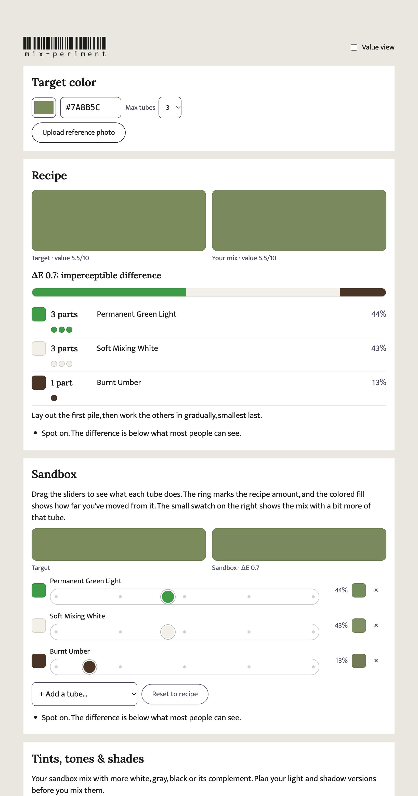

# mix-periment

**Turn any color into an oil-paint recipe using only the tubes you own.**

**[Live demo →](https://hoyinwan07.github.io/mix-periment/)**

Oil paint is expensive, and mixing by trial and error wastes it. Pick a target color (hex, color
picker, or eyedropper on a reference photo) and mix-periment tells you which of _your_ tubes to
mix, in what proportions, how close the result will be, and what to adjust if it's off.



## Features

|                             |                                                                                                                                      |
| --------------------------- | ------------------------------------------------------------------------------------------------------------------------------------ |
| **Recipe in parts**         | "3 parts green, 3 parts white, 1 part umber", ordered from the biggest pile to the smallest; tiny tinting amounts show as "a touch". |
| **Physically based mixing** | Blue + yellow makes green, not gray (spectral Kubelka-Munk, not RGB averaging).                                                      |
| **Accuracy you can trust**  | ΔE2000 score with plain-language meaning, plus a gamut warning when your tubes can't reach a color.                                  |
| **Color-theory coach**      | Tips in the order painters correct a mix (value → chroma → hue), naming the actual tube to reach for.                                |
| **Sandbox**                 | Each bar is a tube's share of the mix; drag one and the others rebalance to 100%.                                                    |
| **Tints, tones & shades**   | Preview the mix with white, a same-value gray, black, or its complement.                                                             |
| **Value view**              | One toggle shows everything in grayscale, to check value without hue in the way.                                                     |
| **Your palette**            | Add, edit, delete tubes; saved in the browser; export/import JSON to move between devices.                                           |

## How it works

```
target hex ─► CIELAB ─┐
                      ├─► solver ─► recipe (parts) ─► coach tips
your tubes ─► spectra ┘     ▲
                            └─ Kubelka-Munk mixing, scored with CIEDE2000
```

1. **Spectral uplifting.** Each tube's color is turned into a smooth reflectance curve
   (380–730 nm, 36 bins) using the sigmoid-polynomial model of Jakob & Hanika (2019).
2. **Mixing.** Single-constant Kubelka-Munk: per wavelength, absorption/scattering (K/S) is
   averaged by amount × tinting strength, then converted back to reflectance and to color with the
   CIE 1931 observer (Wyman, Sloan & Shirley 2013 fit).
3. **Search.** Every 1-, 2- and 3-tube combination on a 5% ratio grid is mixed once and cached per
   palette. Each target is scored against that cache with a cheap Lab distance, the best
   candidates are ranked with CIEDE2000, then fine-tuned. Fewer tubes win near-ties (less waste,
   less mud).
4. **Out of gamut.** CIEDE2000 alone would happily pick a gray of the right value, so the solver
   instead keeps the target's hue and value and binary-searches the most saturated version your
   tubes can reach.
5. **Parts.** Exact ratios are rounded to the smallest whole-number parts that stay within
   1 ΔE of the exact mix.

## Design decisions

- **Zero dependencies, no build step.** Plain HTML/CSS/JS. It runs from any static host or by
  opening `index.html` from disk, which matters in a studio with no network.
- **Plain scripts, not ES modules.** Browsers block module imports over `file://`. Each file is a
  small IIFE that attaches to one namespace (`PM`), loaded in dependency order.
- **Measured before optimizing.** The first version re-mixed everything on every solve (1.6 s for
  an out-of-gamut target with 20 tubes). Caching the candidate mixes and pre-filtering with Lab
  distance brought that to ~90 ms, and typical re-solves to 4–15 ms. That made a Web Worker
  unnecessary (and workers don't run from `file://`).
- **Pure core, thin UI.** Color math, mixing, solving, coaching and formatting have no DOM access
  and are unit-tested in Node. `app.js` only holds state, renders, and wires events.
- **Every tunable in one place.** `src/constants.js` holds each threshold with the reason for its
  value.
- **Safe by construction.** No network calls, a strict Content-Security-Policy, all user text
  rendered via `textContent`, imported files validated, and storage failures (private mode,
  blocked storage) fall back to memory instead of crashing.
- **Accessible.** Native range inputs under the custom slider styling (keyboard and screen-reader
  support), real buttons for file pickers, WCAG AA contrast, `prefers-reduced-motion` respected.

## Accuracy & limitations

- **Default tube colors are estimates.** For best results, paint a swatch of each tube, then set
  its hex (and tinting strength if it overpowers mixes) under _My tubes_.
- **Single-constant Kubelka-Munk** models opaque, fully mixed paint. It doesn't model glazing,
  layering, or transparency.
- **Screens aren't paint.** Monitor calibration and studio lighting shift what you see, and oils
  can shift slightly as they dry. Treat each recipe as a close first mix, then judge by eye.

## Run locally

```bash
npm start        # serves at http://localhost:5173 (python3 -m http.server)
```

Or just open `index.html` in a browser.

## Tests

```bash
npm test         # node:test, no install needed (Node 20+)
npm run format   # Prettier
```

The suite covers the CIEDE2000 implementation against the published Sharma et al. (2005) test
data, mixing invariants (blue + yellow = green, complements neutralize, white only lightens),
solver round-trips and out-of-gamut behavior, share labels always summing to 100%, palette
validation, and storage failure handling.

## Project structure

```
index.html            page structure
style.css             styles (self-hosted fonts in fonts/)
src/
  constants.js        every tunable, with rationale
  color.js            sRGB ↔ CIELAB, LCh, CIEDE2000
  mixer.js            spectral uplifting + Kubelka-Munk mixing
  solver.js           recipe search, gamut mapping, parts rounding
  coach.js            color-theory tips (pure)
  format.js           UI text formatting (pure)
  storage.js          localStorage with in-memory fallback
  palette.js          default tubes, validation, import/export
  ui/slider.js        sandbox slider component
  ui/eyedropper.js    photo color picker component
  app.js              state, rendering, event wiring
tests/                node:test suites
```

## References

- G. Sharma, W. Wu, E. N. Dalal, "The CIEDE2000 Color-Difference Formula: Implementation Notes,
  Supplementary Test Data, and Mathematical Observations," _Color Research & Application_, 2005.
- W. Jakob, J. Hanika, "A Low-Dimensional Function Space for Efficient Spectral Upsampling,"
  _Computer Graphics Forum_ (Eurographics), 2019.
- C. Wyman, P.-P. Sloan, P. Shirley, "Simple Analytic Approximations to the CIE XYZ Color Matching
  Functions," _JCGT_, 2013.
- P. Kubelka, F. Munk, "Ein Beitrag zur Optik der Farbanstriche," 1931.
- M. Livingstone, _Vision and Art: The Biology of Seeing_, 2002 (why value matters most).

## License

Code: [MIT](LICENSE). Fonts (Lora, Mukta Vaani, Libre Barcode 128 Text): SIL Open Font License
1.1, see [`fonts/licenses/`](fonts/licenses).

Not affiliated with Winsor & Newton. Paint names are used only to describe the author's own tubes.
